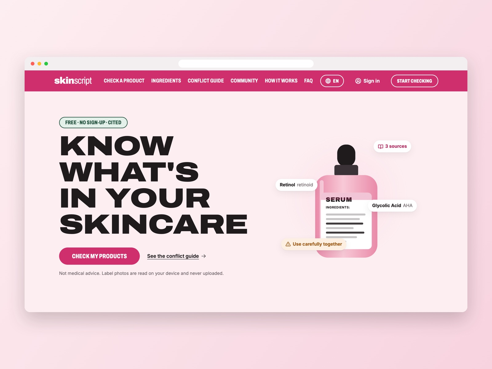
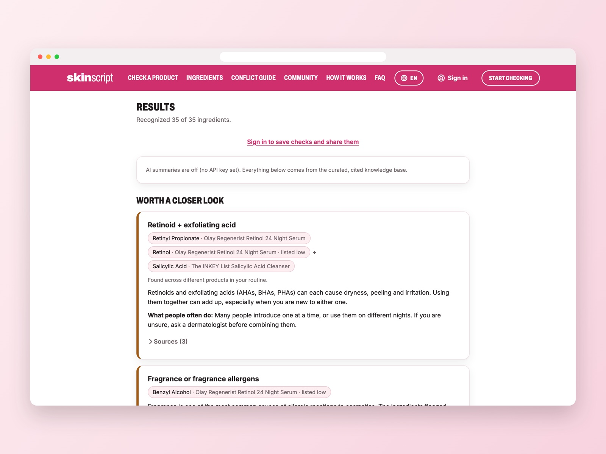
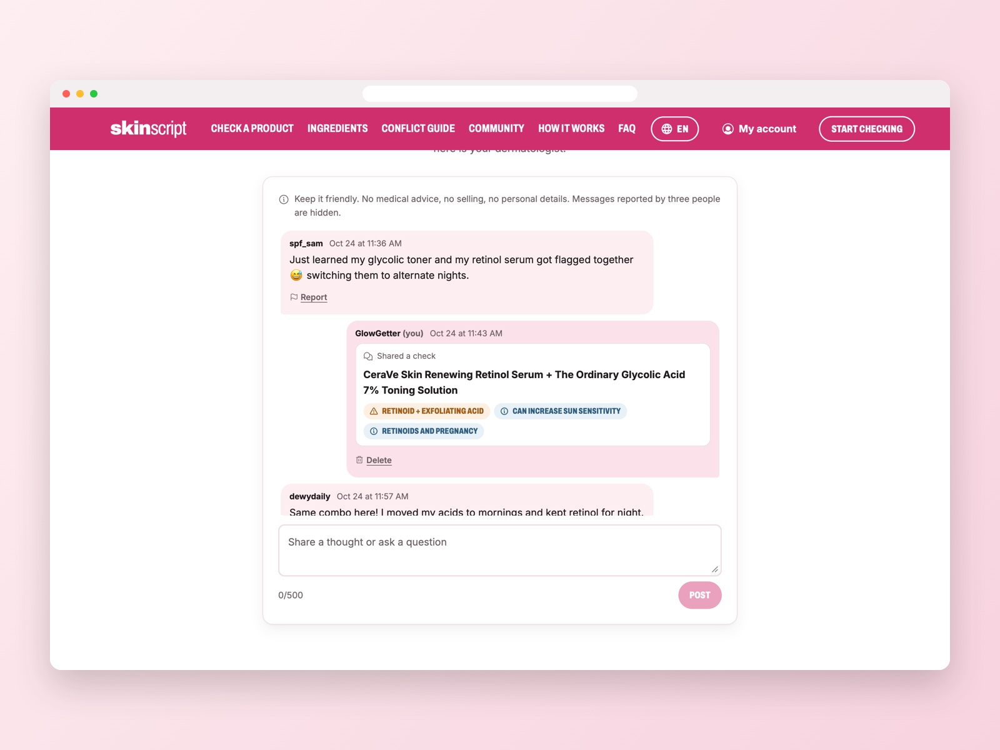
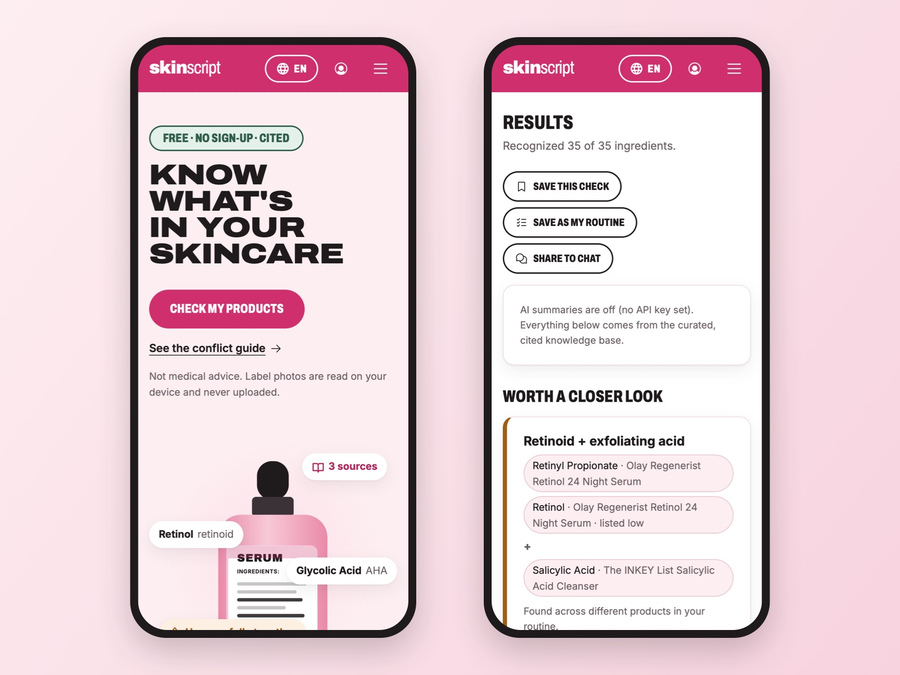
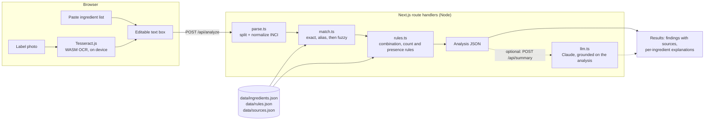

# skinscript: a beauty ingredient checker

**Live demo:** https://noorissa25.github.io/skinscript/

Paste a skincare ingredient list or scan a label photo. The app explains each ingredient in plain language and flags common conflicts (retinoid + exfoliating acids, tretinoin + benzoyl peroxide, vitamin C + benzoyl peroxide) and common irritants (fragrance, essential oils, MI/MCI, formaldehyde releasers). Every flag comes from a small curated knowledge base in [`data/`](data/), and every entry there cites a source. You can check one product or a whole routine of up to four products, since most conflicts happen between products.



| Results for a real routine | Community chat (demo data) |
| --- | --- |
|  |  |



An optional LLM layer writes a friendlier summary, using only the curated data. Without an API key the app still works fully.

> **Not medical advice.** Ingredient lists don't show amounts, and this tool can't tell how a product will affect your skin. For skin conditions, pregnancy, allergies or prescription products, talk to a dermatologist or pharmacist.

## The website

The app is a single-page site under the name **skinscript**. The name, wordmark and tagline live in [`src/lib/brand.ts`](src/lib/brand.ts), so renaming is a one-file change. The layout takes its cues from big beauty-retail homepages: a bold colored nav bar, an oversized hero headline, tabbed product cards and a promo banner. The branding, palette, copy and artwork are original, with no third-party logos or photos.

| Section | What it does |
| --- | --- |
| Hero | Headline, call to action, and an illustrated "label being scanned" (SVG, no stock photos) |
| Check your products | The checker itself: paste or scan, up to four products, results with sources |
| Routine check | A promo-style banner that loads an example two-product routine into the checker |
| Ingredient spotlight | Tabbed cards (Actives, Hydrators, Watch-outs) built from `data/ingredients.json`. Each shows the rules it can trigger and its source count. **Add to checker** appends the ingredient to the checker |
| Conflict guide | Generated from `data/rules.json`: every pairing the checker looks for, with severity, explanation and sources |
| How it works + sources | Three steps, live counts from the knowledge base, and every source with a link |
| FAQ + disclaimer | Privacy, amounts, unrecognized ingredients, routines, the AI summary, and the full disclaimer |

**Design system.** Rose `#D02F6D` for the brand bar and every main button, soft black `#1F1A1C` for headlines and text, and sage `#2F5D4A` as a small accent for gentle tags, all on blush `#FDEEF1`. Colors are defined as CSS tokens in [`src/app/globals.css`](src/app/globals.css) with a matching dark theme. Every text pairing meets WCAG AA (4.5:1). Type is Archivo, using its width axis for the extra-wide hero headlines and the condensed uppercase nav and buttons, with Inter for body text. Icons are Phosphor.

**Languages.** English, Spanish, French, Chinese (Simplified), Hindi and Arabic, chosen from the globe pill in the header. The site picks the browser's language on first visit and remembers the choice. Arabic gets a full right-to-left layout through CSS logical properties. All site text lives in [`src/i18n/messages/`](src/i18n/messages/), one file per language. TypeScript requires every key, and [`tests/i18n.test.ts`](tests/i18n.test.ts) checks that no `{placeholder}` is lost. Ingredient explanations, flags and sources stay in English, with a visible note, because they're health information. The translations were written with AI help and haven't yet been reviewed by native speakers.

**Accessibility.** The site has a skip link, visible focus rings, keyboard-operable tabs (arrow keys) and an accessible mobile menu (Escape closes it). Status messages are announced to screen readers. Buttons, tabs and toggles are at least 44px tall. There's no horizontal scroll at phone widths (checked at 346px and 375px) or on desktop (1280px). The scan animation is turned off for people who prefer reduced motion.

## Architecture



1. **OCR (optional).** Tesseract.js runs in the browser, so photos never leave the device. The text lands in the text box so you can fix OCR mistakes before checking.
2. **Parse.** [`src/lib/parse.ts`](src/lib/parse.ts) finds the `Ingredients:` header (including OCR misreads like `INGREDlENTS`), splits on commas, semicolons, bullets and line breaks, and keeps commas inside parentheses and slashes inside names (`Caprylic/Capric Triglyceride`). It also re-joins words hyphenated across lines, removes percentages, handles US drug-facts `Active/Inactive ingredients` panels, and stops at the paragraph after the list.
3. **Match.** [`src/lib/match.ts`](src/lib/match.ts) looks each name up by INCI name, then by alias or the name in parentheses (`Butyrospermum Parkii (Shea) Butter`). If neither matches, it tries a fuzzy match by edit distance. The typo budget grows with name length, short names must match exactly, and ties between two different ingredients are refused. That way `Niacinamlde` resolves, but `retinxl` is never guessed as either retinol or retinal.
4. **Rules.** [`src/lib/rules.ts`](src/lib/rules.ts) evaluates three kinds of rules from [`data/rules.json`](data/rules.json):
   - *combination*: every tag group must be present, across the whole routine (for example `retinoid` + `aha|bha|pha`)
   - *count*: at least N distinct ingredients with a tag (for example two or more exfoliating acids)
   - *presence*: any ingredient with a tag (for example fragrance allergens)

   Each finding shows its evidence, whether the pairing is inside one product (deliberately formulated) or across products, and notes. One note says an active is listed in the last third of a long list (so it may be present in a small amount). Another says a flag depends on a fuzzy match.
5. **Summary (optional).** [`src/lib/llm.ts`](src/lib/llm.ts) re-runs the analysis on the server and sends the model only the curated descriptions and findings. The system prompt forbids new claims and absolute words like "safe" or "toxic". The route returns `501` when no key is set, and the UI says summaries are off.

## Why Next.js (and not FastAPI + React)

- **One language and shared types.** The parser, rules engine, API and UI all use the types in [`src/lib/types.ts`](src/lib/types.ts). A rule change is checked by the compiler on both sides.
- **No ML runtime on the server.** Matching is deterministic (dictionary + edit distance), and OCR runs as WASM in the browser. Python's ML ecosystem wouldn't add anything yet. If this grows a trained model (for example an NER model for ingredient extraction), a FastAPI service would be the natural next step.
- **Privacy by default.** Running OCR on the client means label photos are never uploaded. The API key stays in a server-only route handler.
- **Easy to run and deploy.** `npm install && npm run dev`, one process, deployable anywhere Node runs.

## Run it locally

Requires Node 24 (see [`.nvmrc`](.nvmrc)). One command installs dependencies and starts the app:

```bash
npm run preview
```

Then open http://localhost:3200. (`npm install` then `npm run dev` also works, on port 3000.) In Claude Code, the same preview is available as `beauty-ingredient-checker` in [`.claude/launch.json`](.claude/launch.json).

Click a sample chip, or **or try the sample label image** to run OCR on [`public/samples/label.png`](public/samples/label.png). The first OCR run downloads the Tesseract engine and English model (a few MB) from a CDN.

To turn on AI summaries, copy `.env.example` to `.env.local` and set `ANTHROPIC_API_KEY`. For accounts and chat, see [Accounts, saved data and community chat](#accounts-saved-data-and-community-chat). `ANTHROPIC_MODEL` is optional and defaults to `claude-opus-5-5`.

| Command | What it does |
| --- | --- |
| `npm test` | Vitest unit tests for parsing, matching, rules, knowledge-base integrity and the API routes |
| `npm run lint` | ESLint (Next.js core-web-vitals + TypeScript rules) |
| `npm run typecheck` | `tsc --noEmit` |
| `npm run build` | Production build |
| `npm run ocr:sample` | Runs Tesseract on the sample label in Node and checks the expected names come out. Needs network on first run, so it isn't part of CI. |

CI ([`.github/workflows/ci.yml`](.github/workflows/ci.yml)) runs lint, typecheck, tests and build on every push and pull request.

## Product search

The search bar at the top of the checker looks up products by name, brand or barcode in [Open Beauty Facts](https://world.openbeautyfacts.org), an open, community-maintained database that includes makeup (ODbL). Requests go through `GET /api/products?q=…` ([`src/lib/products.ts`](src/lib/products.ts)), which:

- returns only products that have an ingredient list;
- removes duplicates of the same product listed under several barcodes;
- prefers the international INCI names over translated lists;
- joins names that were split across lines when the label was typed in.

The chosen product loads into the checker with a link back to its database entry and a reminder to check the packaging. Not every product is listed, so paste and scan still work for anything else.

Retailer sites such as Sephora and Ulta are intentionally not scraped, because their terms don't allow automated collection.

## Accounts, saved data and community chat

Signing in is optional and uses an email link, with no password. Signed-in people can:

- **save checks** and reopen them later;
- **save "my routine"** and reload it in one click;
- keep an **ingredients-to-avoid list**, which is highlighted in every future check;
- join the **community chat**, and share a result card to it.

### Privacy and safety

These rules are enforced in the database ([`supabase/migrations/`](supabase/migrations/)), not just the UI:

- **Owner-only data.** Row-level security limits saved checks, routines and avoid lists to their owner.
- **Public display names only.** Other people only ever see your display name and chat messages, never your email address.
- **Sharing a result is opt-in.** You confirm it first, and the shared card contains only product names and flag titles, never ingredient lists. A test checks this.
- **Posting limits.** A database trigger stamps your display name on each message and limits you to five messages a minute. Messages are capped at 500 characters.
- **Reporting.** Three reports from different people hide a message for everyone.
- **Deletion.** People can delete their own messages, and **Delete my account** removes the account and everything tied to it.

### Setting it up

1. Create a free project at [supabase.com](https://supabase.com).
2. In the SQL editor, run [`supabase/migrations/20261024000000_accounts_and_chat.sql`](supabase/migrations/20261024000000_accounts_and_chat.sql).
3. Under **Authentication → URL configuration**, add your site URL (for example `http://localhost:3200`) as a redirect URL.
4. Copy the project URL and anon key into `.env.local` as `NEXT_PUBLIC_SUPABASE_URL` and `NEXT_PUBLIC_SUPABASE_ANON_KEY`, then restart the dev server.

### Demo mode

Set `NEXT_PUBLIC_SUPABASE_URL=demo` to try every account and chat feature with no backend. An in-browser stand-in ([`src/lib/demoSupabase.ts`](src/lib/demoSupabase.ts)) applies the same rules as the database:

- owner-only rows;
- display-name stamping;
- the posting rate limit;
- hiding after three reports;
- account deletion.

"Sending" the sign-in link signs you in right away, and everything stays in that browser. The same stand-in powers the account tests in [`tests/account.test.ts`](tests/account.test.ts).

## Live demo (GitHub Pages)

[`.github/workflows/pages.yml`](.github/workflows/pages.yml) publishes a static build to https://noorissa25.github.io/skinscript/ on every push to `main`. There's no server and no secrets:

- **Checking ingredients** uses the same rules engine, running in the browser.
- **Scanning a label** runs in the browser, as in the full version.
- **Product search** calls Open Beauty Facts straight from the browser, which its API allows.
- **Accounts, saved checks and chat** run in demo mode, so everything stays in each visitor's own browser. Visitors don't see each other's chat messages.
- **The AI summary** is off.

To preview the same build locally, run the workflow's build step with the same environment variables, then `npm run preview:pages` serves `out/` at http://localhost:3201/skinscript/.

## API

```bash
curl -s localhost:3200/api/analyze \
  -H 'Content-Type: application/json' \
  -d '{"products":[{"name":"Serum","text":"Water, Retinol"},{"name":"Toner","text":"Water, Glycolic Acid"}]}'
```

Returns each product's matched ingredients (with match method and position), the findings with resolved sources, and counts. `POST /api/summary` takes the same body. `GET /api/health` reports whether summaries are enabled.

## Sample inputs

The one-click examples are real products, defined in [`src/lib/samples.ts`](src/lib/samples.ts). Each product cites where its ingredient list came from and when it was retrieved, and the app shows that source under the text box. Formulas change between batches and countries, so the app tells people to check their own packaging.

| Sample | Source | What it shows |
| --- | --- | --- |
| CeraVe Skin Renewing Retinol Serum + The Ordinary Glycolic Acid 7% Toning Solution | Open Beauty Facts | Cross-product retinoid + AHA, sun sensitivity, pregnancy note, citric acid correctly treated as a pH adjuster |
| Olay Regenerist Retinol 24 Night Serum + The INKEY List Salicylic Acid Cleanser | Open Beauty Facts | Retinoid (retinyl propionate) + BHA, and benzyl alcohol flagged as a labeled fragrance allergen |
| CeraVe Hydrating Facial Cleanser, with simulated scan errors | Open Beauty Facts | The real list with typical text-recognition errors added on purpose: garbled header, split word, `Phytosphlngosine` fuzzy-matched |
| CeraVe Moisturizing Cream | cerave.com | No flags. The UI explains this doesn't mean the product suits your skin |
| Sample label image | Made-up product | Text recognition through the whole pipeline: retinoid + BHA, fragrance, sun sensitivity |

Product names are used only to identify the products. This project isn't affiliated with any of these brands.

## The knowledge base

| File | Contents |
| --- | --- |
| [`data/sources.json`](data/sources.json) | 17 sources (FDA, American Academy of Dermatology, DermNet, two peer-reviewed papers, EU CosIng), each with a note on what it is cited for |
| [`data/ingredients.json`](data/ingredients.json) | 150 entries: INCI name, aliases, functions, a plain-language description, tags and source ids |
| [`data/rules.json`](data/rules.json) | 13 rules: severity, explanation, a suggestion phrased as what people often do, and source ids |

Writing guidelines, some of them enforced by [`tests/knowledge.test.ts`](tests/knowledge.test.ts):

- Every ingredient and rule cites at least one source that exists. No name maps to two ingredients.
- Hedged language ("may", "can"). No "safe", "toxic", "clean" or "cures" in user-facing text.
- When the evidence is chemistry rather than a clinical study, the rule says so (see vitamin C + benzoyl peroxide).
- Look-alikes are kept out of active tags on purpose: citric acid (usually a pH adjuster), bakuchiol (not a retinoid), willow bark extract (contains salicin, not salicylic acid), and octisalate / benzyl salicylate (not exfoliants). Tests cover these.
- Plain-language descriptions are the author's summaries. CosIng is cited for names and functions, not for the wording.

To add an ingredient, add an entry with sources, run `npm test`, and add a test if it should trigger a rule.

## Design decisions

- **Rules, not a model, decide the flags.** For health-adjacent guidance, deterministic rules with citations are easier to audit than model output. The LLM can only rephrase what the rules found.
- **Routine-level checking.** Retinol and glycolic acid rarely share a bottle. The rules run over every product together, and each finding says whether the pairing is inside one product (a formulator's choice) or across products.
- **The user stays in the loop on OCR.** OCR text goes into an editable box with a reminder to check it, instead of being analyzed silently.
- **Fuzzy matching is visible.** Close matches are labeled in the ingredient list, and any finding that depends on one says so.
- **Position as a weak signal.** INCI lists are in descending order of concentration above 1%. The app notes when an active sits in the last third of a long list, but never drops a flag because of it.

## Limitations

- **No concentrations.** Labels don't give percentages, so the app can't tell a 0.01% retinol from a 1% one, or a pH-adjusting splash of lactic acid from an exfoliating dose.
- **Small knowledge base.** 150 entries cover common skincare ingredients. Anything else is listed as "not checked" rather than guessed.
- **General guidance, not personal.** The rules don't know your skin type, history, medications or how you layer products.
- **OCR quality varies.** Curved bottles, glare, tiny print and non-English labels will produce errors. Tesseract runs with English only.
- **Fuzzy matching can still be wrong.** A misspelling within the edit budget of a different known ingredient could match the wrong one. That's why fuzzy matches are labeled.
- **The LLM summary isn't exercised in CI**, which has no API key. Tests cover the disabled path and the grounding payload.
- Sources were checked in October 2026. Regulations (for example EU fragrance labeling) change over time.

## Project layout

```
data/                 curated, cited knowledge base (JSON)
src/lib/              parse, match, rules, analyze, llm, validate, samples, types, guide (section data), brand
src/app/              Next.js page, checker UI (Checker.tsx), browser OCR (ocr.ts), styles
src/app/components/   site sections: header, hero, routine banner, spotlight, conflict guide, how it works, FAQ, footer
src/app/api/          analyze, summary and health route handlers
tests/                Vitest suites
scripts/              Node OCR smoke test
public/samples/       sample label image (and its SVG source)
docs/screenshots/     README screenshot
```

## Data credits

Some example ingredient lists come from [Open Beauty Facts](https://world.openbeautyfacts.org), available under the [Open Database License](https://opendatacommons.org/licenses/odbl/1-0/). Individual contents are under the Database Contents License.

## License

Copyright © 2026 Noor Issa. All rights reserved. The code is shared here to view as part of a portfolio; it may not be used, copied, modified or redistributed without written permission. See [LICENSE](LICENSE).
